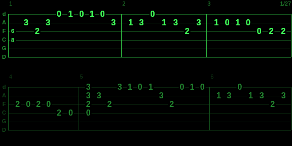

# Glass Tabs

**Guitar Pro tabs on your Even Realities G2.**
**Guitar Pro tablarını Even Realities G2 gözlüğünde okuyun.**

<p>
  
</p>

[English](#english) · [Türkçe](#türkçe)

---

## English

Glass Tabs is an [Even Hub](https://hub.evenrealities.com) plugin. Open a Guitar Pro or MusicXML file on your phone and the tablature appears on the G2 display. The current line is shown on top and the next line underneath, dimmed, so you can read ahead before the page turns.

### Features (v0.1)

- Opens **Guitar Pro 3–7** (`.gp3`, `.gp4`, `.gp5`, `.gpx`, `.gp`) and **MusicXML** files, parsed on the phone with [alphaTab](https://alphatab.net)
- Track picker for multi-track files (guitar, bass, 4–7 strings)
- Real tab staff rendered as an image: string lines, fret numbers, bar numbers, time signatures, repeats, chord names, ties `(3)`, dead notes `x`, harmonics `<12>`
- Optional **right-hand fingering** (p i m a c) for classical guitar
- Spacing follows the rhythm; very dense bars are split across lines
- Remembers the last file, track and position
- A live preview on the phone mirrors the glasses

### Controls on the glasses

| Gesture | Action |
|---|---|
| Swipe forward / down | Next line |
| Swipe back / up | Previous line |
| Tap | Next line (can be turned off) |
| Double tap | Exit |

### Roadmap

- **v0.2 – microphone score following:** the plugin listens through the G2 microphones (or the phone mic placed near the guitar), matches the expected notes and turns the line by itself. The approach uses onset detection and chroma matching against the notes in the file, which suits polyphonic classical guitar.
- Tempo-based auto-scroll as a fallback, with A–B looping
- Grace notes, left-hand fingering, rhythm stems

### Development

```bash
npm install
npm run dev          # Vite dev server on 0.0.0.0:5173
npm run qr           # QR code to sideload into the Even app
npm test             # layout and parser tests
npm run preview:png -- samples/serenade.gp   # render glasses PNGs in Node
npm run pack         # build + package glass-tabs.ehpk
```

How it works: the display has a proportional font, so text-based ASCII tab cannot line up. Glass Tabs draws each 576×288 screen on a canvas and sends it as four 288×144 image tiles. Only the tiles that changed are sent. A full-screen text container behind the images receives the swipe and tap events.

### Credits

- [alphaTab](https://github.com/CoderLine/alphaTab) (MPL-2.0) for file parsing. Sample files in `samples/` come from the alphaTab test suite.
- Display and SDK notes from [even-g2-notes](https://github.com/nickustinov/even-g2-notes).

---

## Türkçe

Glass Tabs bir [Even Hub](https://hub.evenrealities.com) eklentisidir. Telefonda bir Guitar Pro ya da MusicXML dosyası açtığınızda tab G2 ekranında görünür. Üstte o an çalınan satır, altında soluk olarak bir sonraki satır yer alır. Böylece sayfa dönmeden önce ileriyi okuyabilirsiniz.

### Özellikler (v0.1)

- **Guitar Pro 3–7** (`.gp3`, `.gp4`, `.gp5`, `.gpx`, `.gp`) ve **MusicXML** dosyalarını açar. Dosyalar telefonda [alphaTab](https://alphatab.net) ile çözümlenir.
- Çok enstrümanlı dosyalarda parça seçimi (gitar, bas, 4–7 tel)
- Görsel olarak çizilen gerçek tab: teller, perde numaraları, ölçü numaraları, ölçü birimi, tekrarlar, akor adları, bağlı notalar `(3)`, ölü notalar `x`, flajoleler `<12>`
- Klasik gitar için isteğe bağlı **sağ el parmak numaraları** (p i m a c)
- Aralıklar ritme göre ayarlanır; çok yoğun ölçüler birden fazla satıra bölünür
- Son dosyayı, parçayı ve konumu hatırlar
- Telefondaki canlı önizleme gözlükte görüneni birebir gösterir

### Gözlükte kontroller

| Hareket | İşlev |
|---|---|
| İleri / aşağı kaydırma | Sonraki satır |
| Geri / yukarı kaydırma | Önceki satır |
| Dokunma | Sonraki satır (kapatılabilir) |
| Çift dokunma | Çıkış |

### Yol haritası

- **v0.2 – mikrofonla nota takibi:** Eklenti G2 mikrofonlarıyla ya da gitarın yanına konan telefon mikrofonuyla dinler, dosyada beklenen notaları eşleştirir ve satırı kendisi çevirir. Nota başlangıcı algılama ve kroma eşleştirmesine dayanan bu yöntem, çok sesli klasik gitara uygundur.
- Yedek mod olarak tempoya göre otomatik kaydırma ve A–B döngüsü
- Süs notaları, sol el parmak numaraları, ritim sapları

### Geliştirme

Komutlar için yukarıdaki İngilizce bölüme bakın.

Nasıl çalışır: Gözlüğün fontu orantılı olduğu için metin tabanlı ASCII tab hizalanamaz. Glass Tabs her 576×288 ekranı bir canvas üzerine çizer ve dört adet 288×144 görsel parça olarak gönderir. Yalnızca değişen parçalar gönderilir. Görsellerin arkasındaki tam ekran metin kutusu kaydırma ve dokunma olaylarını yakalar.

## License / Lisans

MIT
